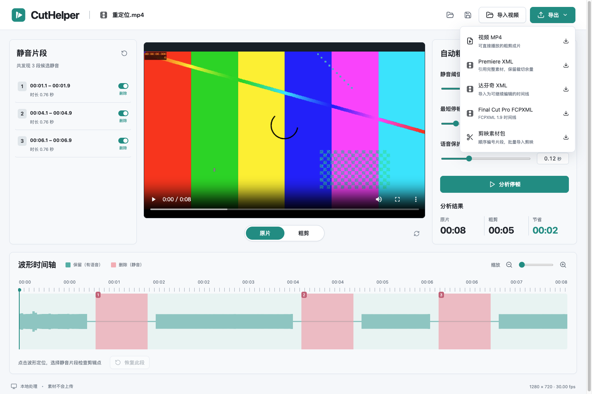
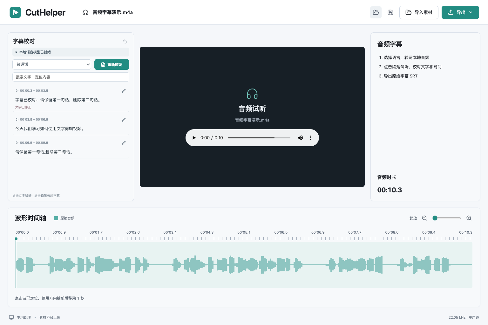
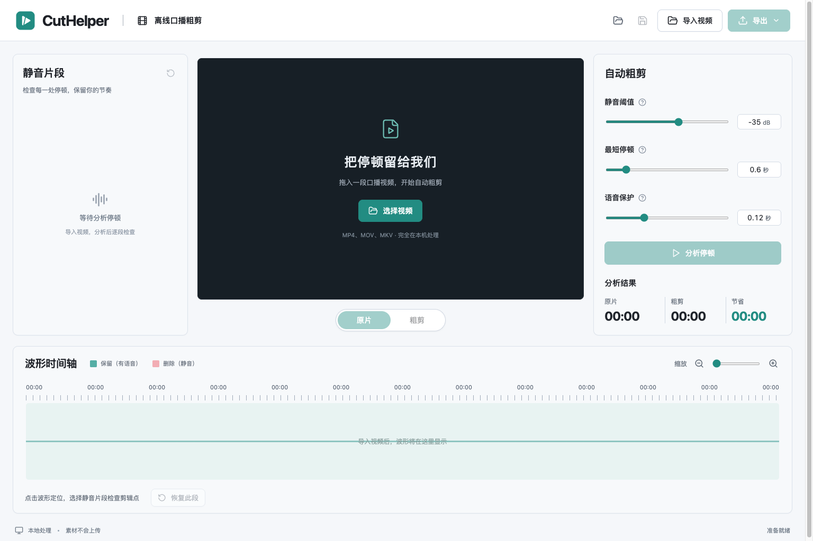

<p align="center">
  
</p>

<h1 align="center">CutHelper</h1>

<p align="center">像读文稿一样剪视频，保留你的表达节奏。</p>
<p align="center">离线文字剪辑与口播粗剪 · macOS / Windows · 无账号 · 素材不上传</p>

CutHelper 是一个桌面端剪辑辅助工具，适合课程、访谈、自媒体口播。导入视频后，在本机转写文字，按段落删减内容，并结合静音检测去除停顿，最后导出粗剪视频、编辑器时间线和同步字幕。

## 应用界面



*真实桌面应用截图：离线普通话转写、文字删减、原片定位、静音参数、波形时间线和多格式导出。演示视频由本地合成语音与应用图标画面组成。*

<details>
<summary>查看音频字幕工作台</summary>



</details>

<details>
<summary>查看导入界面</summary>



</details>

## 主要功能

- **离线文字剪辑**：普通话 / 英语 / 自动识别，点击段落定位原片，播放时高亮当前段落。
- **按段落删减**：勾选、Shift 连选、批量删除和恢复；支持撤销剪辑，修正识别错字不会改变视频时长。
- **离线字幕**：直接导入视频或 MP3、WAV、M4A 音频，试听并校对字幕文字和时间。
- **两套字幕时间轴**：原始 SRT 保留全部文字，粗剪 SRT 跳过删除内容并对齐成片。

- **自动粗剪**：根据音量和停顿时长检测静音，为语音两侧保留可调保护区。
- **检查与恢复**：片段列表、波形和播放位置联动，逐段保留或删除。
- **真实预览**：切换原片与粗剪；人工修改后重新生成预览，避免播放旧结果。
- **五种导出**：MP4、Premiere XML、达芬奇 XML、Final Cut Pro FCPXML、剪映分段素材包。
- **本地项目**：保存参数和人工选择，素材移动后可重新定位。
- **常见素材处理**：保留 29.97 fps 等有理数帧率，处理可变帧率和手机旋转信息。

## 获取桌面版

当前源码版本为 **v0.3.0**。已发布的安装包可从 [Releases](https://github.com/misanyrock/cutHelper/releases) 的 Assets 下载，也可从 [Actions 构建运行](https://github.com/misanyrock/cutHelper/actions/workflows/build.yml)的 Artifacts 下载。

在项目目录运行 `npm run dist:mac` 或 `npm run dist:win` 可生成安装包。Mac 包为未签名本地构建；Windows 和专业剪辑软件实际导入兼容性仍待对应环境验证。

## 开发与运行

使用 Node.js 22 LTS、npm、CMake，以及 C/C++ 编译工具（Mac 的 Xcode Command Line Tools，Windows 的 Visual Studio C++ 工具）：

```sh
git clone https://github.com/misanyrock/cutHelper.git
cd cutHelper
npm ci
npm run dev
```

首次开发安装需联网下载 Electron、FFmpeg、npm 依赖和固定版本 whisper.cpp 源码；第一次启动会编译语音运行时。安装包自带 FFmpeg、FFprobe 和离线语音运行时，使用者无需安装编译器。语音模型单独准备，下载或导入后可完全离线转写。`npm run dev` 会启动 Vite 并打开真实桌面窗口，关闭桌面窗口后开发服务器退出。修改主进程或 preload 后需重启开发命令。

```sh
npm test                 # 区间与格式单元测试、真实 FFmpeg 集成测试
npm run build            # TypeScript 检查、前端和主进程编译
npm run test:desktop     # 构建后验证原有静音剪辑桌面流程
npm run speech:prepare   # 首次编译离线语音运行时，后续复用缓存
node scripts/speech-test-model.mjs  # 下载并校验语音集成测试所需的 tiny 模型和音频
npm run test:speech      # 真实本地模型转写、缓存、删句、SRT 与视频导出
npm run test:transcript  # 真实桌面文字剪辑流程；可通过 CUTHELPER_TEST_MODEL / CUTHELPER_TEST_AUDIO 指定测试素材
CUTHELPER_TEST_MEDIA=audio npm run test:transcript  # 纯音频导入、试听、校对时间、保存重开及 SRT 导出（Bash / Zsh）
npm run pack             # 本机可运行的应用目录
npm run dist:mac         # 在 Mac 上生成 DMG
npm run dist:win         # 在 Windows 上生成 NSIS 安装包
```

桌面测试需要可用的图形桌面会话，测试对话框由自动化适配，不会操作用户素材。测试样本创建在系统临时目录。构建产物位于 `release/`，不进入 Git。支持当前 macOS 的 Apple Silicon 开发与打包；Windows x64 构建配置见 `.github/workflows/build.yml`。跨平台安装包需在对应系统构建、验证，不将本机 Mac 验证等同于 Windows 验证。

## 字幕与文字剪辑

1. 点击「导入素材」或拖入一个视频（MP4、MOV、MKV）或音频（MP3、WAV、M4A）。在左侧点击「下载模型」，准备 Small 多语言模型（约 465 MiB），或导入已有 whisper.cpp GGML `.bin` 模型。下载支持取消，并校验固定版本模型的 SHA256。
2. 选择普通话、英语或自动识别，点击「转写文字」。转写使用本地音频与模型，不上传素材；相同素材、模型和语言的成功结果会缓存。
3. 点击文字或时间戳定位原素材。点铅笔按钮修正文字或调整开始、结束时间，再点「完成修正」。字幕时间与剪辑点独立保存。模型提供可用时间戳时，应用会按句末标点和停顿细分段落，并在导出时为长字幕换行。
4. 选择「导出 → 原始字幕 SRT」，即可给原视频或音频配字幕。视频还可以选择「粗剪字幕 SRT」，字幕会跟随成片时间并跳过删除内容。
5. 视频项目可以勾选段落后删除，Shift 点击可连续选择。文字删除与静音删除取并集；如某段文字恢复后仍被静音剪切，可点击「恢复该处静音」。Cmd/Ctrl+Z 可在非输入框区域撤销。
6. 保存项目会保留转写、字幕校对和删除选择。旧项目可以直接打开。音频项目和手动字幕时间请使用 v0.3.0 或更新版本。

纯音频进入字幕模式，提供波形试听、文字和时间校对，以及原始 SRT 导出。

识别段落并不保证逐字或精确语义句子边界，剪切前应试听核对。口头禅自动删除、重复内容识别、说话人区分及逐字剪辑尚未实现。模型的实际语言能力以所导入模型为准；默认 Small 模型支持多语言。

## 静音粗剪

1. 点击「导入素材」或拖入一个 MP4、MOV、MKV。导入会检查帧率、读取波形并生成可播放的预览，长视频可能需要等待。
2. 默认以 −35 dB 检测至少 0.6 秒的静音，在语音两侧各保留 0.12 秒。点「分析停顿」。轻声被切掉时降低阈值，停顿太碎时增大最短停顿。
3. 在左侧或波形选择候选静音，切换保留/删除；也可恢复全部。波形点击定位，方向键以 1 秒移动播放位置。
4. 点「粗剪」生成并播放真实粗剪预览。修改片段后回到原片，下次切换粗剪会重新生成；参数变化需重新分析后才会改变片段。
5. 顶部保存图标将当前参数、分析参数和人工选择保存为 `.cuthelper.json`。打开项目时，若原素材缺失或发生变化，按提示重新定位同一视频。项目引用素材，不嵌入视频。
6. 点「导出」选择需要的格式。导出前请确认保留区间；全静音时需恢复至少一段。任务可取消，失败不会将未完成文件写成最终成片。

## 导出兼容

| 输出 | 使用方式 | 保留裁切余量 |
| --- | --- | --- |
| MP4 | H.264 / AAC，可直接播放；重新编码，源分辨率 | 否 |
| 原始字幕 SRT | 给原视频或音频配字幕，保留全部文字与原素材时间 | 不适用 |
| 粗剪字幕 SRT | 字幕跳过删除内容，时间与粗剪视频同步 | 不适用 |
| Premiere XML | Premiere 的文件 → 导入，传统 FCP 7 XML | 是 |
| 达芬奇 XML | DaVinci Resolve 的文件 → 导入 → 时间线 | 是 |
| Final Cut Pro FCPXML | Final Cut Pro 的文件 → 导入 → XML，FCPXML 1.9 | 是 |
| 剪映素材包 | 批量导入按文件名编号的 MP4 并依次拖入时间线 | 否 |

时间线文件旁附导入说明，原素材需保持可访问，移动后在编辑器中重新链接。Premiere 使用的传统 XML 与 Final Cut Pro FCPXML 是不同格式。剪映输出为真实独立视频片段，不是私有原生草稿。

可变帧率素材先生成 30 fps 恒定帧率工作副本，界面会提示；视频、预览和时间线共用工作副本。导出时间线时将完整工作副本复制到旁边的 `*-媒体` 目录，一起保留该目录。携带旋转信息的手机视频会先转换为正确方向的工作副本。恒定帧率素材保留源有理数帧率，例如 30000/1001。项目与编码区间内部以整数微秒表达，最终统一对齐视频帧。

## v0.1.1 修复

修复部分素材点击粗剪预览时报 `media.fpsNum` 超过 100 万的问题。帧率是分数，较大的分子、分母依然可能表示正常帧率；现在保留 FFmpeg 支持的合法有理数，读取时只做无损约分，并在平均帧率无效时回退到有效的轨道帧率。回归测试包含大分子/分母素材的真实预览编码。

## 首版边界

- 一次一个 SDR 视频，使用首个非封面视频轨与首个音轨，输出最多双声道。多机位、多音轨混音、特效和转场尚未支持。
- v0.2.0 的 Mac 应用要求 macOS 13.3 或更新版本。转写速度取决于素材、模型和硬件，Windows / Intel 可通过导入较小的多语言模型降低资源需求。
- 静音检测按音量判断，不理解语义；带持续背景音乐的素材、口误和重复语句需要人工处理。
- 应用预览使用 720p 代理；最终 MP4 保持工作素材分辨率。HDR 会提示先转成 SDR。
- 应用数据在 Electron 的用户数据目录 `CutHelper/media`（开发模式可能为 `cuthelper/media`）。包含恒定帧率副本与临时预览；同级 `speech/` 目录保存模型和转写缓存；正常退出会清理本次预览。保存的项目可能引用工作副本，不应在使用项目期间删除整个数据目录。
- 首版为未签名本地构建，没有公开发布或自动更新。Windows、Premiere、Resolve、Final Cut Pro 的实际导入测试须在具备对应系统及软件的环境完成；结构测试不等同于软件导入兼容认证。

## 图标与品牌资源

新图标以青绿色圆角方形为底，将播放符号和剪切断口组合在一起。页头、Dock、窗口和安装包共用这一标识。

- `public/icon.svg`：可编辑的矢量源文件，同时用于界面和 favicon。
- `public/icon.png`：1024 × 1024 透明背景 PNG。
- `build/icon.icns` / `build/icon.ico`：Mac / Windows 安装包图标。

修改 SVG 后，使用已安装的 Google Chrome 运行 `npm run icons`，生成各平台资源。生成结果随源码提交，日常构建和 CI 不需要安装 Chrome。

## 验证与当前状态

| 检查 | 状态 |
| --- | --- |
| TypeScript 与生产构建 | 通过 |
| 剪辑模型、字幕、XML 与真实 FFmpeg 测试 | 22 项通过，另有真实模型集成测试 |
| macOS 打包应用完整工作流 | 已验证普通话文字剪辑、字幕修正、SRT/MP4 导出、撤销恢复、保存重开；原有静音与编辑器导出另外回归 |
| macOS 音频字幕 | 已验证真实 M4A 转写、试听定位、字幕时间校对、原始 SRT 导出与保存重开 |
| 桌面和窄屏界面 | 已检查；桌面 1536 × 1024、窄屏 390 × 844 |
| Windows 运行 / 专业编辑器内导入 | 待对应环境验证 |

## 推送标签自动打包

推送 `v*` 标签会自动运行 `.github/workflows/build.yml`，也可在 [Actions → Build desktop](https://github.com/misanyrock/cutHelper/actions/workflows/build.yml) 手动运行。

每次构建先校验标签与 `package.json` 版本一致，再安装依赖、运行真实媒体测试，最后分别生成：

| 平台 | 安装包 | Actions 产物名称 |
| --- | --- | --- |
| macOS Apple Silicon | `.dmg` | `CutHelper-版本-macOS-arm64` |
| macOS Intel | `.dmg` | `CutHelper-版本-macOS-x64` |
| Windows x64 | `.exe`（NSIS） | `CutHelper-版本-Windows-x64` |

后续发布新版本，在干净的 `main` 分支运行：

```sh
npm version patch -m "chore: release %s"
git push origin main --follow-tags
```

`npm version patch` 会同步更新版本号、创建提交和版本标签。请勿只创建标签而不更新 `package.json` 和 `package-lock.json`，版本不一致时三个平台都会在校验步骤失败。标签必须指向包含新工作流的提交，旧标签不会自动回补构建；已推送的版本标签不应改写。

版本标签下的三个平台全部构建成功后，工作流会自动创建对应的 GitHub Release（已存在则复用），并上传两个 `.dmg` 和一个 `.exe`，可直接在 **Releases → Assets** 下载。重跑会替换同名安装包；在 Actions 手动运行时选择 `v*` 标签也会发布，选择分支则只构建。

Actions 运行页面的 **Artifacts** 仍保留各平台安装包压缩包，保留期为 30 天。旧运行不会自动回补 Release 附件；该工作流不发布自动更新，Mac 包仍为未签名构建。

## 仓库规则

`.gitignore` 排除依赖、编译结果、安装包、用户视频和音频、项目文件、缓存、测试报告和本地凭据。文档截图、图标及必要设计参考保留在仓库中。请勿提交个人素材或 API 密钥。

## 代码结构

`electron/`：受限 IPC、媒体子进程、项目文件、XML 导出。`shared/`：项目校验、帧与时间换算、剪辑模型。`src/`：React 工作台及波形、参数、片段组件。`tests/`：纯逻辑及真实媒体测试。设计基准见 `docs/design/workspace.png` 和 `docs/design/spec.md`。

IPC 提供受限的导入、静音分析、模型管理、离线转写、预览、项目读写、导出、取消与任务进度；渲染进程无 Node.js 权限。播放 URL 使用内部令牌映射，不提供任意文件 URL。FFmpeg 以参数数组执行，无 shell 拼接。导出临时文件位于目标目录，成功后重命名完成写入。

应用源码遵循 [Apache-2.0](LICENSE)；媒体二进制及其他第三方许可见 [第三方说明](docs/THIRD_PARTY.md)。
